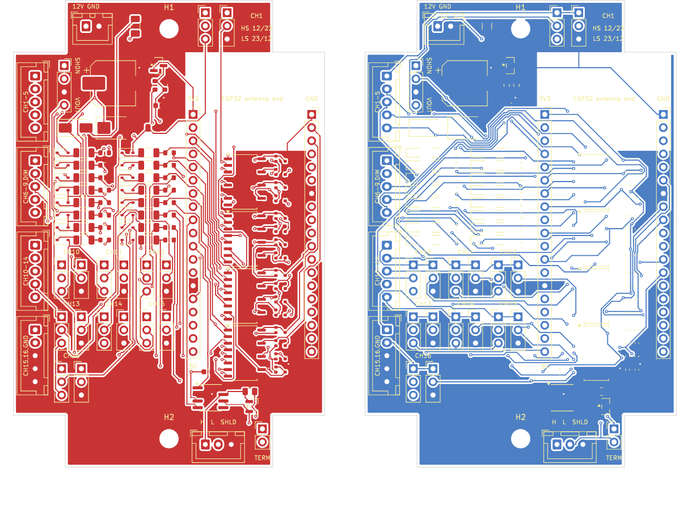

# 928 Signal Module: PCB rev A handoff

**For:** the Claude conversation that produced *928 Signal Module Schematic rev 2*
and *1984 928 S Cluster Plug Signal Map rev 2*.
**Purpose:** bring that conversation in sync with the PCB layout. It lists every
decision made during layout, every place the board differs from the rev 2
schematic and why, the reference-designator mapping, connector pinouts, and
what still has to be checked before ordering.

**Source of truth from here on:** `designs/signal_module_928.py` in the
`bapshago/pcbforge` repo. It holds the netlist, part choices and placement.
`tests/test_signal_module_928.py` checks every connection against the rev 2
schematic. If the schematic changes, update the design file and the test
together, then rebuild.

---

## 1. Decisions made during layout

| Topic | Decision |
|---|---|
| Assembly | JLCPCB assembles everything, top side only. |
| 5 V supply | **Pololu D36V6F5** module (50 V in) on a 1x4 socket. The LMR38010 is not on the board. |
| Board | 60 x 90 mm with 10 x 10 mm notches in all four corners. Two M3 holes on the centre line, 79 mm apart (y = 5.5 and 84.5 mm). Fits the 100 x 68 x 50 mm enclosure. 2 layers, 1.6 mm. |
| Input connectors | Four **JST B5B-XH-A** (5-pin, 2.5 mm), with spare positions used as ground pins. |
| Power and CAN connectors | JST **B2B-XH-A** (J1) and **B3B-XH-A** (J2) to match. |
| ESP32 | Your own **AITRIP 38-pin ESP-32S board (ESP-WROOM-32)** plugs into two 1x19 female sockets. It has the same pinout as Espressif's DevKitC V4, and its header rows are **22.86 mm (0.9") apart** (the seller's drawing). |
| CAN transceiver | Bare **SN65HVD230DR** (SOIC-8) on the board, not the WCMCU-230 breakout. |

## 2. Differences from schematic rev 2

Each one is marked `REV A CHANGE` (or `REV A ADDITION`) in the design file.

1. **CAN transceiver.** The WCMCU-230 breakout is replaced by the bare SN65HVD230DR
   (LCSC C12084). Most WCMCU-230 boards carry their own 120 Ω terminator, which
   would wrongly terminate the bus at a tap. Termination is now only R10 + JP10,
   left open because the module is a tap. The wiring is unchanged: D = CAN_TX
   (GPIO27), R = CAN_RX (GPIO25), Rs to GND (high-speed mode), VCC 3V3 with
   C12 100 nF, Vref unconnected.
2. **CAN ESD protection added (D12).** NUP2105L dual-line CAN protector (SOT-23)
   on CANH and CANL at J2, common pin to GND.
3. **5 V regulator.** U10 is the Pololu D36V6F5 module (pololu.com/product/3792)
   on socket **J9**, pins in the module's order SHDN, VIN, GND, VOUT. SHDN is
   left open, so the module is always on.
4. **C10 is 47 µF 63 V** (8 x 10.5 mm SMD can) instead of 100 µF 63 V
   (a 10 mm can). That's enough because Pololu asks for at least 33 µF across
   VIN when the input can exceed 28 V, and the TVS clamps near 39 V.
5. **D11 symbol.** The schematic draws it as bidirectional, but the BOM part
   (SMBJ24A) is unidirectional. The board uses the unidirectional part, cathode
   to +12V_SW, which is correct with D10 ahead of it.
6. **Input connectors added (J3–J6).** The schematic had no landing point for the
   cluster signals. Pinouts are in section 4.
7. **1N4148 → 1N4148WS** (SOD-323 SMD), the same diode for JLCPCB assembly.
8. **PC847 → Toshiba TLP291-4(GB)** (SOP-16, LCSC C60900): a quad phototransistor
   optocoupler with the same pin pattern. The DIP-16-size PC847 (about 21 mm long)
   doesn't fit between the ESP32 board's 22.86 mm header rows; the TLP291-4
   (about 10 x 9 mm) does. Its GB grade guarantees at least
   100 % CTR at 5 mA; this circuit needs only about 10 % (0.33 mA to pull the
   10 k pull-up low from 3.5 mA of LED current at 9 V). The LED reverse rating
   is still about 5 V, so D1 stays.
9. **R3 (10 kΩ) and C1 (10 nF) are 0402** instead of the 0603 used elsewhere,
   so they fit beside the optocouplers under the ESP32 board. Same values.
10. **R1 (2.2 kΩ) is 1206, 0.25 W.** Your design doc allows "1206 or ½ W". Steady
    dissipation is about 55 mW at 13.8 V and 80 mW at 15 V, and a 40 V spike
    (about 0.7 W) only lasts milliseconds.
11. **F1 is an SMD 1206 1 A fuse** on the board. Keep the inline blade fuse in the
    harness as well.
12. **Optional SMAJ18A per-input TVS: not fitted** (no room). Per your design doc,
    R1 alone limits a 40 V spike to about 18 mA through the LED.
13. **Grounds.** Car ground (9R) and ESP32 ground are **one net, GND**, because
    they're tied through the 5 V supply anyway. The optos protect the inputs
    against spikes, reverse voltage and ground offsets on the signal wires;
    they don't isolate the grounds. This matches what the schematic does
    electrically.

Not changed: every channel circuit (D1, R1, R2, opto, R3 10 k pull-up to 3V3,
C1 10 nF), channel types, the jumpers (1x3 header + shunt on all 8 universal
channels, as in your BOM), the GPIO map, the dimmer divider (R4 47 k, R5 10 k,
C2 100 nF, BAT54S clamp to GPIO39/ADC1), and the power chain order (F1 → D10 SS34
→ D11 TVS + C10 + C11 → regulator).

## 3. Reference designators: schematic → board

The schematic reuses "R1, R2, …" in every channel. The board gives each part a
unique reference built from the channel number *n* (1–16):

| Schematic | Board | Part |
|---|---|---|
| D1 (per channel) | **D(100+n)**, e.g. D105 for CH5 | 1N4148WS, SOD-323 |
| R1 | **R(100+n)** | 2.2 kΩ 1206 |
| R2 | **R(200+n)** | 10 kΩ 0603 |
| R3 | **R(300+n)** | 10 kΩ 0402 |
| C1 | **C(100+n)** | 10 nF 0402 |
| JP1 / JP2 (universal channels) | **JP(100+n) / JP(200+n)** | 1x3 header + shunt |
| U3–U6 | **U3** = CH1–4, **U4** = CH5–8, **U5** = CH9–12, **U6** = CH13–16 | TLP291-4 |
| U1 (DevKitC) | sockets **J7** (DevKitC header J2) and **J8** (DevKitC header J3) | 1x19 female |
| U10 (regulator) | socket **J9** | 1x4 female, Pololu D36V6F5 |
| U2, R4, R5, R10, C2, C10, C11, C12, D3, D10, D11, F1, JP10, J1, J2 | same as the schematic | |
| (new) | **D12** | NUP2105L CAN ESD |
| (new) | **J3–J6** | input connectors |
| (new) | **H1, H2** | M3 mounting holes |

Optocoupler channel *k* inside each package (k = 1–4): anode pin 2k−1,
cathode pin 2k, collector pin 18−2k, emitter pin 17−2k (emitters to GND).

## 4. Connector pinouts

Pin 1 is marked on the silkscreen by the square pad.

| Conn | Pin 1 | Pin 2 | Pin 3 | Pin 4 | Pin 5 |
|---|---|---|---|---|---|
| **J1** power (B2B-XH) | +12 V switched (cluster **3R**) | GND (cluster **9R**) | | | |
| **J2** CAN (B3B-XH) | CAN-H | CAN-L | shield drain → GND | | |
| **J3** inputs | CH1 turn (**13L**) | CH2 high beam (**1M**) | CH3 lights on (**6L**) | CH4 central warn (**5M**) | CH5 brake fluid (**1R**) |
| **J4** inputs | CH6 brake pad (**12R**) | CH7 brake warn (**5R**) | CH8 park brake (**6R**) | CH9 washer (**10L**) | DIM dash dimmer (**14R**) |
| **J5** inputs | CH10 spare | CH11 spare | CH12 spare | CH13 spare | CH14 spare |
| **J6** inputs | CH15 spare | CH16 spare | GND | GND | GND |

- **J2 shield:** the drain goes to GND on this board. Ground it at one end of the
  cable only, so leave it unconnected at the far end.
- **J2 as built (Oct 2026):** fitted with a 2-pin **B2B-XH-A** in the H and L
  positions; the SHLD hole is left open. If a shield is needed, solder the drain
  wire straight into the SHLD hole (it's GND).
- **JP10** (CAN terminator): leave open (the module is a tap).
- **CH1 jumpers JP101/JP201** (silkscreen "HS 12/23" and "LS 23/12"):
  high-side = JP101 1–2 and JP201 2–3; low-side = JP101 2–3 and JP201 1–2.
- **Spare-channel jumpers JP110–JP116 / JP210–JP216:** a labelled pair per
  channel (CH10 … CH16 on the silkscreen), JP1 on the left and JP2 on the
  right, with the same positions as CH1.

## 5. ESP32 pin map (unchanged from rev 2)

| Ch | Signal | GPIO | Socket pin |
|---|---|---|---|
| CH1 | Turn signal | 34 | J7-5 |
| CH2 | High beam | 35 | J7-6 |
| CH3 | Lights on | 32 | J7-7 |
| CH4 | Central warning | 33 | J7-8 |
| CH5 | Brake fluid | 26 | J7-10 |
| CH6 | Brake pad | 14 | J7-12 |
| CH7 | Brake warning | 13 | J7-15 |
| CH8 | Parking brake | 16 | J8-12 |
| CH9 | Washer fluid | 17 | J8-11 |
| CH10–16 | Spares | 18, 19, 21, 22, 23, 4, 36 | J8-9, J8-8, J8-6, J8-3, J8-2, J8-13, J7-3 |
| DIM | Dash dimmer | 39 (ADC1) | J7-4 |
| CAN | TX / RX | 27 / 25 | J7-11 / J7-9 |
| Power | 5V in / 3V3 out / GND | | J7-19 / J7-1 / J7-14, J8-1, J8-7 |

Firmware notes stay as they were: inputs are **active-low** (GPIO reads 0 when
the 12 V signal is active), 20 ms debounce, ADC on GPIO39 only (ADC1 works with
Wi-Fi on), CAN at 500 kbit/s.

## 5b. Firmware and CAN frame

Arduino sketch: `firmware/signal_module_928/` (Arduino IDE, "esp32 by
Espressif Systems" package, board "ESP32 Dev Module"). It sends one 8-byte
frame on **ID 0x31B (795)**, next to the 0x31A ZombieVerter frame the 928
Waveshare dash already reads, at 500 kbit/s: every 100 ms, and immediately
when an input changes. The ID, the period, the CAN mode (send / listen
only / off) and the Wi-Fi name and password are set on the module's web page
(http://192.168.4.1/settings) and kept in flash; it also takes firmware
updates over Wi-Fi. Bus protection: single-shot frames, listen-first, ID
conflict stop, bus-off back-off. Details in the firmware README.

| Byte | Content |
|---|---|
| 0 | CH1–CH8, bit 0 = CH1, 1 = active |
| 1 | CH9–CH16, bit 0 = CH9 |
| 2–3 | Dash dimmer voltage, little-endian, 0.1 V/bit |
| 4 | Dash dimmer level, 0–100 % of 14.0 V |
| 5 | Rolling counter |
| 6 | bit 0 = turn signal flashing |
| 7 | Frame layout version (1) |

The board's CAN pins are TX = GPIO27 and RX = GPIO25, the reverse of the
AngryPixieDash board. The firmware README has a suggested decoder case for
the dash's `leaf_can.c`.

## 6. Board layout summary

- **Top tab:** J1 power connector, F1, M3 hole H1, CH1 jumper headers.
- **Top left:** Pololu socket J9, C10, D10, D11, C11, dimmer parts (R4, R5, C2, D3).
- **Left edge:** input connectors J3–J6, top to bottom.
- **Left middle:** the channel input parts (D1, R1, R2) in two columns of eight
  rows: CH1–8 on the left, CH9–16 on the right, CH1 and CH9 at the top.
- **Under the ESP32 board**, between its sockets: the four optocouplers in one
  column (U3 at the top), LED pins facing left toward the input parts, with
  each channel's R3 pull-up and C1 filter cap beside its output pin on the
  right. Everything there is under 3 mm tall; the ESP32 board sits roughly
  10 mm up on its sockets.
  Nothing is placed under the module's antenna (the first ~7 mm below the
  sockets' pin 1).
- **Bottom left:** the jumper header pairs for CH10–CH16.
- **Bottom right**, just below the ESP32 board: U2 CAN transceiver, C12, R10, D12; bottom tab: J2 CAN
  connector, JP10, M3 hole H2.
- **Routing:** autorouted (Freerouting), 2 layers, 0.2 mm tracks, plus a GND pour
  on both layers. There's no pour under the ESP32 module's antenna, so
  Wi-Fi/BT still work. Pads join the pour solidly, with no thermal
  spokes; the spokes got starved on this dense board. If you hand-solder the
  through-hole GND pins (connectors, sockets), use a hot iron (350 °C or more).
- **Heights:** the tallest item is the Pololu module on its socket (about 21 mm),
  then the ESP32 board (about 15 mm). The enclosure has about 35 mm inside.

## 7. Check before ordering (open items)

1. **ESP32 board row spacing:** the board uses **22.86 mm**, from the AITRIP
   drawing. A quick check with calipers (outside of one pin to outside of the
   pin opposite, minus one pin width) costs nothing.
2. **ESP32 board orientation:** the antenna end points to the top tab, USB
   toward the bottom. The **3V3** pin sits at the top of the left socket, and
   **GND** at the top of the right socket; both are labelled on the silkscreen.
   Plugging it in reversed puts 5 V on a GPIO.
3. **Pololu orientation:** the pin order is confirmed from Pololu's photo of the
   back of the D36V6F5: SHDN, VIN, GND, VOUT. Socket J9 matches, with SHDN on
   pin 1 (square pad, top) and VOUT at the bottom; both ends are labelled on the
   silkscreen. The module fits either way round, so line up the SHDN printed
   on its back with the SHDN label. Backwards puts 12 V on its GND pin.
4. **LCSC part numbers:** every assembled part now carries the LCSC number
   it was ordered with (first order, Oct 2026), and
   `fab/signal_module_928_rev_a/signal_module_928-bom-as-ordered.csv` records
   the confirmed BOM.
5. **Through-hole parts** (XH connectors, sockets, headers): order them with
   JLCPCB's THT assembly, or solder them yourself (it's easy).
6. **JLCPCB placement preview:** on the first order the SOIC parts (U2–U6)
   and SOT-23 parts (D3, D12) appeared rotated (by 90° and 180°) and were fixed by hand. The
   CPL file now pre-rotates them (SOIC 270°, SOT-23 180°), so they should
   preview correctly; still glance at them before confirming.
7. **Meter the car** before wiring: 3R / 9R power, CH1 polarity (13L), and every
   cluster pin, as the signal map already says.
8. **USB and car power together:** check whether your ESP32 board has a diode
   between USB 5 V and the 5V pin before connecting USB while the car powers
   the board.

## 8. Build status and outputs

**Board rev A status:** fully placed and routed for the 22.86 mm ESP32 board.
KiCad DRC reports **0 errors, 0 warnings, 0 unconnected**: 123 parts, 93 nets,
2 layers with a ground pour.

A ready-made snapshot sits in `fab/signal_module_928_rev_a/`: the KiCad board,
Gerber zip, JLCPCB BOM and CPL, and the DRC report.
`docs/signal_module_928_outline.dxf` has just the board outline and the M3
holes, for enclosure work. The enclosure is the 100 x 68 x 50 mm box in
`docs/enclosure_100x68x50.png` (maker's drawing, ±2 mm): its two internal
standoffs are 79 mm apart on centre, which sets the board's hole spacing. Buy
link: https://a.co/d/0giEBknB (Amazon; two more ordered Oct 29, 2026).

To rebuild (about 4 minutes; up to 3 routing attempts if needed):

    pcbforge build designs/signal_module_928.py

The outputs land in `build/signal_module_928/`.

**Nov 1, 2026: board 1 installed in the '81 928.** Firmware working; the dash uses the dimmer, lights on, high beam and turn signal from 0x31B. First pcbforge board in real use.

### Bench test log (board 1, Oct 28 2026): bench tested

Firmware with the Wi-Fi status page; inputs probed with +12 V / GND from a bench supply.

| Test | Result |
|---|---|
| 12.6 V on J1 before the Pololu was fitted; 5 V at the ESP32 5V pin after | pass |
| Low-side CH4–CH9: GND → ACTIVE, +12 V → no change | pass |
| High-side CH2, CH3: +12 V → ACTIVE, GND → no change | pass |
| Dimmer (J4-5): 12.6 V in reads 12.6 V (90 %) | pass |
| Universal CH1, CH10–CH16: no shunts → no response; HS and LS with shunts | pass |
| CH16 high-side: no response at first; a cold joint, fixed by resoldering | fixed |
| CH1 turn-signal "flashing" flag | to do |
| CAN at 500 kbit/s against a second signal board running `can_monitor_928` (JP10 on both): 0x31B at 10/s, 0 repeats, 0 rx/tx errors, inputs decoded; monitor's test frames acknowledged | pass |
| (A WCMCU-230 breakout tried first received but never drove the bus: faulty module, not this board) | note |

## 9. Instructions for Claude (to keep things in sync)

- Treat this document plus `designs/signal_module_928.py` as the current state
  of the hardware. Schematic rev 2 is the circuit intent; board rev A is what
  gets built.
- Don't reintroduce the WCMCU-230 breakout, an on-board LMR38010, or separate
  car/ESP32 ground nets without saying so explicitly; each was a deliberate
  change (section 2).
- Any change to a channel's circuit, GPIO or connector pin must be reflected in
  the design file **and** in `tests/test_signal_module_928.py`.
- The next schematic revision should show J3–J6, D12, the Pololu socket J9, the
  DevKitC sockets J7/J8, and the board reference designators from section 3.
